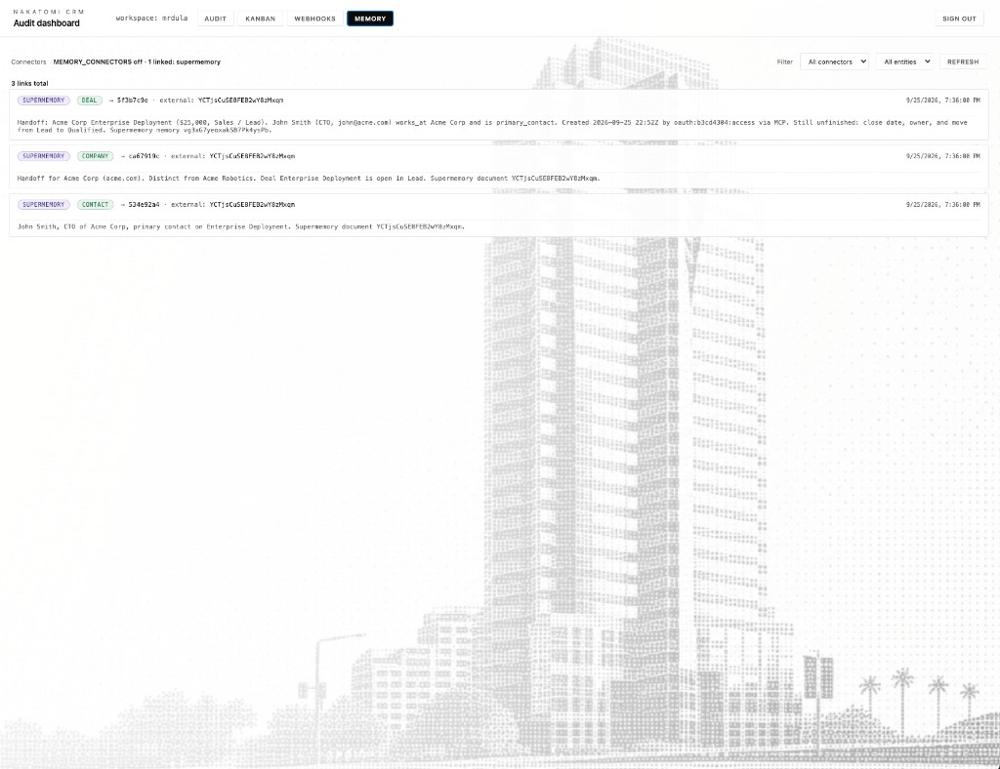

# Audit dashboard

Read-only operator UI at **`/dashboard`**. Agents use MCP/REST; humans use the dashboard to **audit** timeline, pipeline, webhooks, and memory links.

**Wiki (screenshots + tour):** [GitHub Wiki — Dashboard](https://github.com/mrdulasolutions/NakatomiCRM/wiki/Dashboard)

---

## Sign in

Open **`/dashboard`** and sign in with your Nakatomi email and password or a configured Google or GitHub provider. Select a workspace if you belong to more than one. The server stores your session and invalidates it when you sign out. Set `DASHBOARD_ENABLED=false` to disable the dashboard.

For Railway, configure `ENVIRONMENT=production` and a strong `SECRET_KEY`. Set `PUBLIC_BASE_URL` to your canonical HTTPS origin when using a custom domain. The app otherwise uses the Railway service domain. Use that same origin for the provider callback URLs.

## Views

| Tab | Purpose |
| --- | --- |
| **Audit** | Timeline + recent contacts/companies/deals + open tasks + webhook strip |
| **Kanban** | Read-only pipeline board (up to 4k deals) |
| **Webhooks** | Subscribers + expandable delivery log |
| **Memory** | `MemoryLink` inspector + connector env banner |

### Screenshots

Same assets as the wiki (`docs/assets/dashboard/`):

| Audit | Kanban |
| --- | --- |
|  |  |

| Webhooks | Memory |
| --- | --- |
|  |  |

The Memory tab distinguishes **`MEMORY_CONNECTORS`** (server adapters) from **link rows** created via MCP `memory_link` or REST — see [MEMORY.md](./MEMORY.md).

---

## Connect an agent

Workspace owners and admins can open **Connect an agent** to copy the MCP URL, issue a dedicated headless credential, test a read-only tool, and disconnect credentials. Read-only is the default. Select **Allow CRM writes** when the bot needs to modify records.

- **Grok API and headless DOTs:** point the runtime at the displayed HTTPS `/mcp` URL. Store the credential in the runtime’s secret store and pass it as MCP authorization. Displayed credentials can be copied once.
- **Interactive DOTs and MCP clients:** use the same URL and approve the workspace and scopes in the browser. `mcp` grants reads and `mcp:write` requests CRM writes. Clients refresh delegated tokens with their registered client ID.
- **Multiple Railway replicas:** validate your clients with `MCP_STATELESS_HTTP=true` before scaling so requests do not depend on in-memory session affinity.

Existing OAuth access tokens with legacy wildcard permissions are retired during upgrade. Clients that have a valid refresh token and their registered client ID can renew. Reconnect clients that cannot refresh. Workspace API keys issued outside OAuth continue to work.

See [SSO setup](SSO.md) for provider callbacks.
