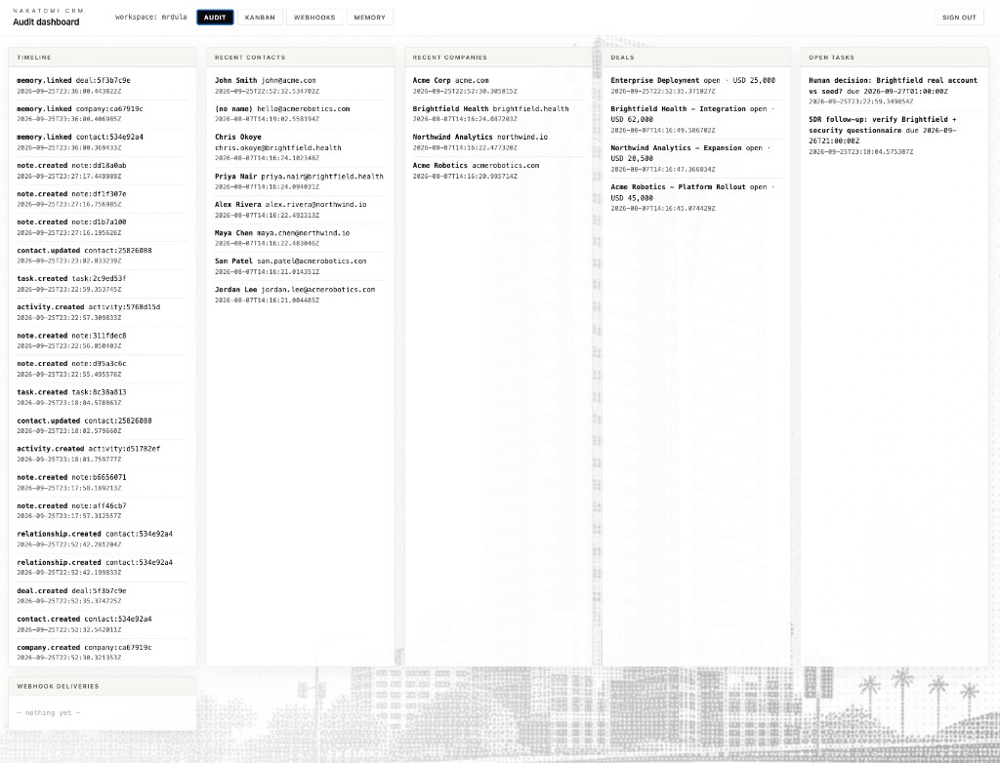
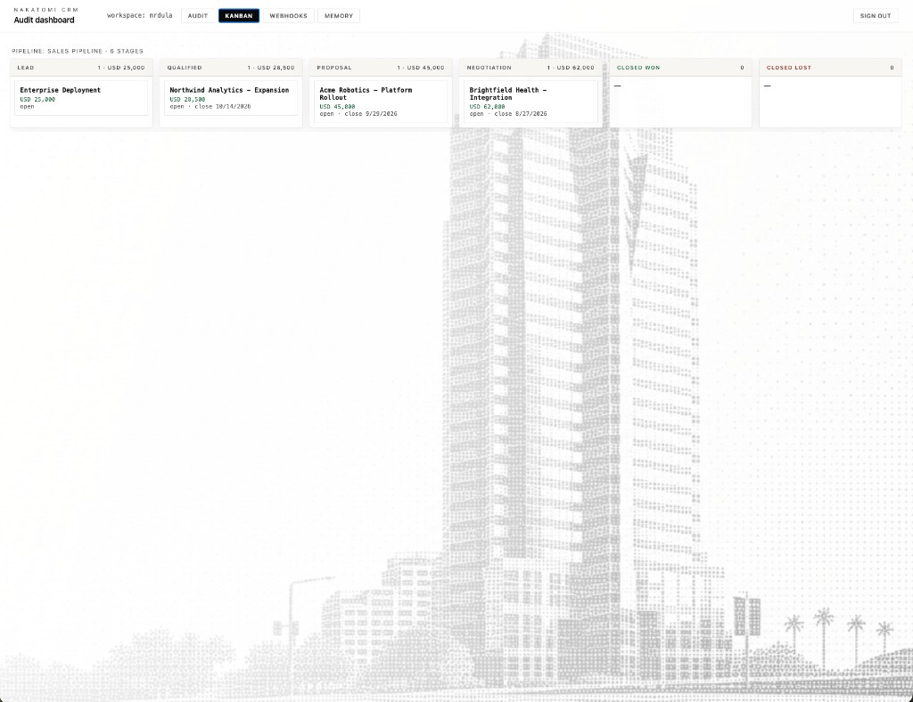

# Audit dashboard

Use **`/dashboard`** to inspect workspace activity and manage agent connections.

> Session sign-in and agent onboarding are pending in [PR #31](https://github.com/mrdulasolutions/NakatomiCRM/pull/31). ZIP exports are pending in [PR #32](https://github.com/mrdulasolutions/NakatomiCRM/pull/32). Keep the dashboard disabled on public deployments until the safety review and staging checks are complete.

**Wiki (screenshots + tour):** [GitHub Wiki — Dashboard](https://github.com/mrdulasolutions/NakatomiCRM/wiki/Dashboard)

---

## Sign in

Open **`/dashboard`** and sign in with your Nakatomi email and password or a configured Google or GitHub provider. Select a workspace if you belong to more than one. The server stores your session and invalidates it when you sign out. Set `DASHBOARD_ENABLED=false` to disable the dashboard.

For Railway, configure `ENVIRONMENT=production` and a strong `SECRET_KEY`. Set `PUBLIC_BASE_URL` to your canonical HTTPS origin when using a custom domain. The app otherwise uses the Railway service domain. Use that same origin for the provider callback URLs.

## Password recovery

Use **Forgot password?** on the dashboard or the MCP authorization page.
Password-based accounts can request a single-use link valid for 20 minutes
after the operator configures recovery email. SSO-only users recover access
through their identity provider.

Set `RECOVERY_FROM_ADDRESS` to a sender approved by your mail provider.
Set `RECOVERY_RESEND_API_KEY` to deliver over HTTPS through Resend. This option
works on Railway plans that block outbound SMTP and takes precedence when configured.
For SMTP delivery, configure `RECOVERY_SMTP_HOST`,
`RECOVERY_SMTP_PORT`, `RECOVERY_FROM_ADDRESS`, and the SMTP username and
password when required. Port 587 uses STARTTLS by default and port 465 uses
implicit TLS. For a local test mail relay, explicitly allow its hostname in
`INTEGRATION_PRIVATE_HOSTS` and set `RECOVERY_SMTP_USE_TLS=false` if needed.

| Deployment | Recovery link origin | Operator reset |
| --- | --- | --- |
| Railway | Uses the Railway public domain. Set `PUBLIC_BASE_URL` for a custom domain. | In the app service's Railway SSH terminal, run `python -m app reset-password --email owner@example.com`. |
| VPS | Set `PUBLIC_BASE_URL` to the public HTTPS origin. | Run the same command in the app environment, or prefix it with `docker compose exec app`. |
| Local | Set `PUBLIC_BASE_URL=http://localhost:8000` or your actual loopback URL. | Run the same command in the local Python environment, or prefix it with `docker compose exec app`. |

The operator command works without a mail provider and prompts for the password without
echoing it. Use the database for the existing installation. Both recovery
paths preserve the account and workspace memberships and revoke browser
sessions. Existing API keys and agent grants retain their own revocation
controls. Run Alembic migration 0019 before using the flow.

## Views

| Tab | Purpose |
| --- | --- |
| **Audit** | Timeline + recent contacts/companies/deals + open tasks + webhook strip |
| **Kanban** | Read-only pipeline board (up to 4k deals) |
| **Webhooks** | Subscribers + expandable delivery log |
| **Memory** | `MemoryLink` inspector + connector env banner |

### Screenshots

Same assets as the wiki (`docs/assets/dashboard/`):

| Audit | Kanban |
| --- | --- |
|  |  |

| Webhooks | Memory |
| --- | --- |
|  |  |

The Memory tab distinguishes **`MEMORY_CONNECTORS`** (server adapters) from **link rows** created via MCP `memory_link` or REST — see [MEMORY.md](./MEMORY.md).

---

## Connect an agent

Workspace owners and admins can open **Connect an agent** to copy the MCP URL, issue a dedicated headless credential, test a read-only tool, and disconnect credentials. Read-only is the default. Select **Allow CRM writes** when the bot needs to modify records.

- **Grok API and headless DOTs:** point the runtime at the displayed HTTPS `/mcp` URL. Store the credential in the runtime’s secret store and pass it as MCP authorization. Displayed credentials can be copied once.
- **Interactive DOTs and MCP clients:** use the same URL and approve the workspace and scopes in the browser. `mcp` grants reads and `mcp:write` requests CRM writes. Clients refresh delegated tokens with their registered client ID.
- **Multiple Railway replicas:** validate your clients with `MCP_STATELESS_HTTP=true` before scaling so requests do not depend on in-memory session affinity.

Existing OAuth access tokens with legacy wildcard permissions are retired during upgrade. Clients that have a valid refresh token and their registered client ID can renew. Reconnect clients that cannot refresh. Workspace API keys issued outside OAuth continue to work.

See [SSO setup](SSO.md) for provider callbacks.

## Export a workspace through an agent

Ask a connected agent to **export this workspace as a ZIP for Railway**, a VPS,
or local use. The agent calls `export_workspace_zip` and returns a browser
download link valid for 10 minutes. Share that link only with the intended
recipient. The download is generated from the current workspace when opened.

The workspace ZIP is intended for import into an existing installation. It includes the portable workspace JSON, a manifest, and restore
instructions for the selected target. Ask to include attachments or timeline
history if you need them. An owner or admin can enable **Allow workspace ZIP exports** when creating a
headless agent credential. Interactive OAuth agents must request `mcp:export` and receive owner or admin
approval. Attachment bytes also require `files:read`.
